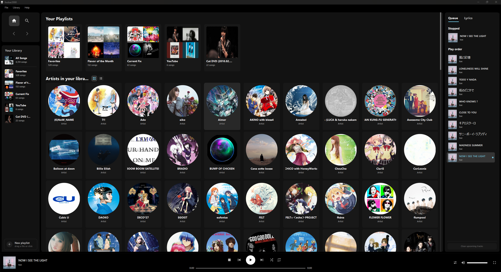
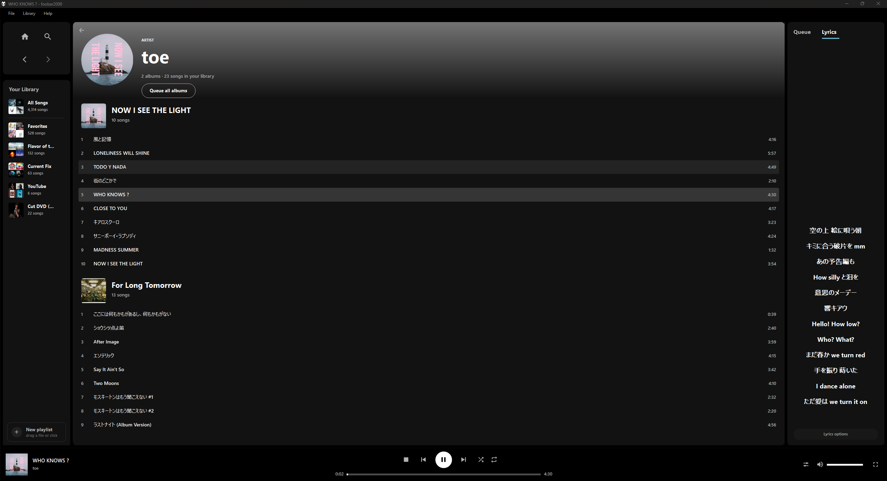
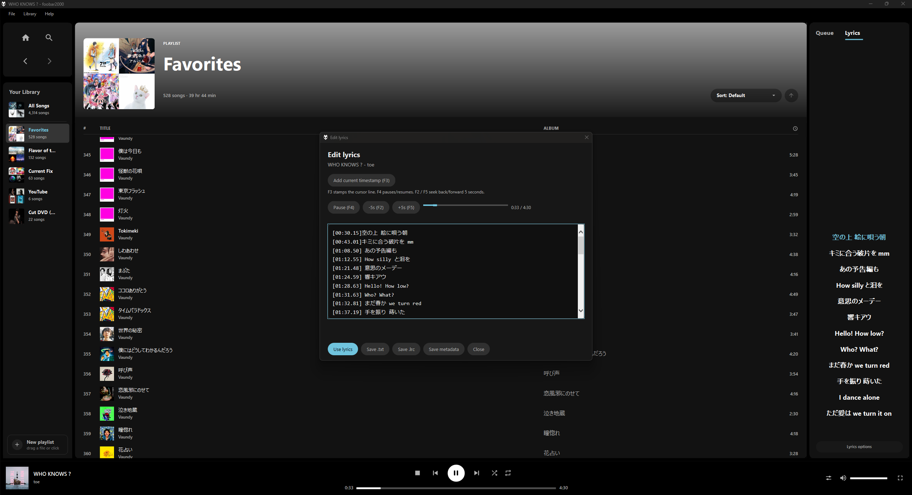

<div align="center">

# Otoha — 音葉

### Your music, your own canopy.

*Each song is a leaf. Together, they form a music library that’s uniquely yours.*

[Source code](https://github.com/cliffhuang0611/otoha-foobar2000-theme/tree/main) · [Based on Verdant](https://github.com/superziper/verdant-foobar2000-theme)


**`main` is the default branch for Otoha.**



</div>

---

**Otoha** is a **foobar2000 theme** for your local music collection, with a charcoal interface,
Frosted Cyan accents, an editable playback order, and integrated lyric search and timing tools.

Its name combines **音 (*oto*, sound)** and **葉 (*ha*, leaf)**: individual songs become the leaves
of a collection that grows differently for every listener. Otoha is based on
[Verdant by superziper](https://github.com/superziper/verdant-foobar2000-theme), with its own
visual identity and expanded library, navigation, queue, and lyrics workflows.

Everything on screen is custom-drawn in a [JSplitter](https://hydrogenaud.io/) panel running under
[Columns UI](https://github.com/reupen/columns_ui) — sidebar, home, playlist and All Songs views,
search, queue and lyrics pane, player bar, fullscreen mode, and the menu strip beneath the native Windows title bar. No stock
foobar2000 widgets are involved, which is why it looks nothing like default foobar2000.

Otoha plays your local music through foobar2000. Online lyric lookup uses LRCLIB only when
you choose to search. It does not connect to Spotify.

---

## Install

Otoha installs directly into **foobar2000 v2, 64-bit** on Windows 10 or 11.
It uses **Columns UI** and **JSplitter**, included under `components/` in this repository.
No Verdant installation, window-management component, extra fonts, or JavaScript build step is required.

### Install manually

1. Install [foobar2000](https://www.foobar2000.org/download), choosing **64-bit**.
   To test Otoha separately, choose **Portable installation** in a new folder.
2. Download this repository’s `main` branch using **Code → Download ZIP** and extract it.
3. Close foobar2000. Find its **profile folder**:
   - Standard installation: `%APPDATA%\foobar2000-v2\`.
   - Portable installation: `<foobar2000 folder>\profile\`.
   Back up that folder before changing an existing setup.
4. Copy the component folders from `components/` into `<profile>\user-components-x64\`.
   Keep any existing installations of Columns UI or JSplitter rather than replacing them.
5. Copy **the contents of `theme/otoha/`** into `<profile>\otoha\`.
6. Start foobar2000 and select **Columns UI** when asked. If needed, select it under
   Preferences → Display and restart.
7. Open Preferences → Display → Columns UI and click **Import configuration**.
   Import **`dist-config\otoha-layout.fcl`**, selecting its **Main Layout**, **Toolbar Layout**,
   and **Misc Layout** entries where offered. Release packages put the FCL in `extras/`.
8. Apply the changes. If JSplitter cannot find the script, right-click its panel → **Configure**
   and set the profile-relative file path to **`otoha\main.js`**, then reload.
9. Add your music folders under Preferences → **Media Library**.

Copy theme scripts and components only. **Do not copy CFG files or `config.sqlite` into your
profile.** Let your own foobar2000 installation create its configuration.
For an existing Columns UI setup, export your current configuration before importing Otoha so
that you can restore your preferred layout later.

### Updating Otoha

Close foobar2000 and back up `<profile>\otoha\`, then replace its contents with the latest
`theme/otoha/` files. Keep your existing layout, panel properties, and profile configuration.
Start foobar2000 again. No component reinstall or layout import is needed for ordinary script updates.

### Switching from an earlier Verdant-based setup

Copy Otoha’s scripts into `<profile>\otoha\`, then change your existing JSplitter panel’s file
script path from `verdant\main.js` to `otoha\main.js`. If it uses an absolute path, change the
folder portion to `otoha`. Apply and reload; keeping the same panel retains its properties.
Old Play order state is not migrated. Start playback again to create an Otoha Play order.
Check any global `Verdant: …` keyboard bindings against the renamed `Otoha: …` commands.
Once the new setup works, the old theme folder can be removed.

### Remove Otoha

Stop playback, then choose the interface you want to use:

- **Default User Interface:** open Preferences → Display, select **Default User Interface**,
  and restart. Skip the Columns UI steps below and go directly to **Delete Otoha’s files**.
- **Keep Columns UI:** replace its Otoha layout using the following steps before deleting the scripts.

1. Open **File → Preferences → Display → Columns UI**.
2. Click **Quick setup** on the **Main/Setup** page (the label depends on your Columns UI version).
   Choose a built-in layout with a normal playlist, such as **Playlist switcher**, and confirm.
   If you exported your previous configuration, you can import that instead.
3. Confirm that the normal playlist interface works. Under the **Layout** page, remove any
   other saved presets containing the Otoha JSplitter panel, if you created additional ones.

**Delete Otoha’s files — for either interface:**

1. Close foobar2000. Delete only the Otoha script folder for your installation:
   - **Standard installation:** press Win+R, enter `%APPDATA%\foobar2000-v2`, and delete the
     **`otoha`** folder inside it. Keep the rest of the profile.
   - **Portable installation:** open your foobar2000 installation folder, then `profile`, and
     delete only **`profile\otoha\`**.
2. Start foobar2000 again. Your music library, personal playlists, output device, and DSP settings remain.

If you chose Default User Interface, Columns UI’s saved Otoha layout remains inactive.
Before switching back to Columns UI later, use its **Quick setup** to replace that layout;
otherwise JSplitter will report the deleted `otoha\main.js` script as missing.

Columns UI and JSplitter can stay installed. Remove either through Preferences → Components
only if you no longer use it for another layout. Otoha’s internal playlists (`__otoha_…`) and
`Otoha: …` keyboard bindings can also be removed through foobar2000 if no longer needed.
Deleting playlists does not require deleting their music files.
**Do not delete your entire profile or `config.sqlite` to remove Otoha.**

**Already deleted the scripts and seeing a red JSplitter panel?** Close the error dialog and use
Columns UI’s **Quick setup** as described above. The message about `otoha\main.js` means the
saved layout points to a missing script; it does not mean the whole foobar2000 installation is corrupt.

To reinstall, copy `theme/otoha/` into the profile again and import `otoha-layout.fcl`.
You do not need to reinstall components that are still present.
Optional installer backups are disabled by default. To request them, run:

```powershell
.\tools\install.bat -FoobarRoot 'C:\Path\To\Your\foobar2000' -Backup
```

Replace the example path with your installation folder. Backups are created only when existing
files are replaced; the newest **three managed backup sets** are retained (`-KeepBackups` changes
that limit). Older backup folders from previous installer versions are left alone.
Each explicit backup includes `restore-backup.bat`; restoring it may bring back a previous Otoha
setup, so use the manual removal procedure above when you want to stop using the theme.


---

## What Otoha adds

This fork builds on [superziper/verdant-foobar2000-theme](https://github.com/superziper/verdant-foobar2000-theme).
The features below describe Otoha’s `main` branch compared with upstream Verdant.
Original features such as shuffle, fullscreen, visualizers, cover mosaics, and ReplayGain remain
available. Theme files live in `otoha`, and registered menu commands use `Otoha: …`.
Otoha installs independently; a Verdant installation is not required.

### Home and responsive layout

- **Artist Grid/List toggle** beside **Artists in your library**. The heading and controls scroll
  with the section, then stick to the top. The view choice is saved in panel properties.
- **Your Playlists always stays a horizontal card shelf**, regardless of the artist display mode.
  The shelf reserves the vertical scrollbar gutter, including its click targets.
- **One shared vertical scroll offset** across Grid/List: toggling retains the visible pixel position,
  clamped to the new layout's maximum. The playlist shelf keeps its horizontal position too.
- **Resizable playlist sidebar**: drag its right-hand gap. The saved width is limited to leave room
  for the main content. Truncated playlist names show full-name hover tooltips in the sidebar and Home.
- **Compact queue controls**: narrow windows can expand/collapse the queue. It defaults to open
  while playing or paused and closed while stopped. A manual toggle overrides automatic visibility
  until JSplitter reloads, including across subsequent track changes. The expanded queue occupies
  its own layout space so it cannot cover main scrollbars. Expand is near the main panel's
  right edge; Collapse is inside the queue, below the tabs when space is especially tight.
- Responsive headings, search/filter fields, sorting/grouping controls, and menus accommodate
  smaller windows. Custom flyouts paint above other content; track menus close on outside clicks,
  Escape, or focus loss. Clicking the top menu bar also dismisses an open context menu.

### Playlists and track selection

- **Default sorting preserves foobar2000's stored playlist order**, including imported M3U8 order.
  Title/Artist/Album sorting changes the display only. The direction button keeps its space but is
  disabled for Default; the previous direction is remembered for named sorts.
  **Apply displayed sort to playlist** writes the full displayed sort into the stored playlist
  order, including tracks hidden by a filter, and switches the view back to Default.
- **Windows-style track selection**: Ctrl-click toggles individual tracks; Shift-click selects ranges;
  Ctrl+Shift-click adds ranges. Arrow-key selection uses the current displayed order. Duplicate
  entries can be selected independently. Modified double-clicks do not start playback.
- **Track clipboard**: Ctrl+C copies selected tracks from playlists, All Songs, artist, album, and
  Search views in displayed order, preserving duplicates. Ctrl+X cuts only from editable playlists,
  after a successful clipboard copy. Ctrl+V appends to the open editable playlist. Audio files are
  unchanged by cut/paste. The clipboard uses foobar2000's native track format.
- Track right-click menus provide Add to playlist (existing or new), Add to playback queue,
  Open containing folder, Properties, Delete files, and playlist removal where applicable.
  **Show more options** opens foobar2000's full native track menu, including installed File Operations
  and Converter commands/presets for the selected tracks.
- **Play order** shows one finite playback sequence with the current occurrence highlighted in
  the accent color, including earlier and upcoming tracks. Repeat all wraps through that same sequence;
  repeat one keeps the current occurrence highlighted rather than adding another copy.
  Deliberately queued duplicate tracks remain separate entries.
- Right-click a Play order row or press **Delete** with the queue focused to remove that occurrence.
  **Ctrl-click** toggles individual occurrences; **Shift-click** selects a range, and **Ctrl+Shift-click**
  adds a range to the selection. Dragging moves the selection as one block in its original order.
  Delete and the track context menu remove selected occurrences together while keeping the playing
  or paused occurrence. Playlist drops and track context actions also use the complete selection.
  The playing/paused occurrence is protected; source playlists and files are kept. Drag main-view
  track rows into the queue to copy them at the insertion marker, or into blank space below the list
  to append. Selected tracks retain their source order, and the queue scrolls near its edges.
  A cursor-following preview shows cover art, title, artist, and the number of tracks being added;
  reordering within Play order also shows a track preview.
  Multiple-track drags use stacked covers, a selection count, up to three title/artist previews,
  and a count of the remaining tracks.
  Dragging tracks onto a sidebar playlist or Home playlist card appends copies to that playlist.
  Dropping onto **New playlist** creates and opens a playlist containing the dragged tracks.
  These targets also accept a track dragged from Play order; locked/automatic playlists reject drops.
  With the queue focused, **Ctrl+V** pastes tracks after the last selected occurrence, or at the end when
  no row is selected. These edits are included in the retained playback order.
- Stop retains the full Play order and highlights the track ready to play, including when using
  foobar2000's native Stop command. The retained order and exact current occurrence survive closing
  and reopening foobar2000. Play starts that retained track at 0:00 and continues the same sequence.
- Tracks changing or repeat wrapping automatically reveals the current row. Manual scrolling
  stays put between track changes; hover and ordinary redraws do not pull you back.
- Drag any visible row to reorder playback without changing the saved playlist or restarting
  the current track. Single-click selects; double-click plays that occurrence in the same full
  sequence. Escape cancels a drag, and playback/list changes invalidate a stale drop.
- The list scrolls independently with a wheel/scrollbar; dragging near its edges scrolls it
  automatically. Tabs, Now playing and the footer stay fixed.
- **Clear upcoming tracks** in the footer or context menu asks for confirmation. It removes
  the remaining sequence and stops after the current track, with empty actions disabled.
- Reordered playback, the current position and hidden handoff identity survive JSplitter reloads.
  With repeat off, playback ends at the final track; repeat does not create an infinite UI list.
- **Stop button** beside Previous ends playback immediately and retains the stopped track and full Play order
  sequence, including across panel reloads. Play restarts that track at 0:00; Pause resumes at its
  existing position. Starting another track replaces the retained sequence. Shuffle and Repeat form a smaller pair on the queue side, keeping Play/Pause centered.
- When no track is loaded, the player uses a neutral music-note placeholder with Nothing playing
  (or Ready to play when queued tracks are available), instead of a colored cover block.
- Artist-track double-click plays within that album. Right-click a track to add its whole album
  or all of the artist's displayed albums to Play order; the artist header also has Queue all albums.
  When Shuffle is on, the entire added batch is shuffled across albums; with Shuffle off,
  tracks retain the displayed album/disc/track order. Existing queued tracks keep their order.
  Turning Shuffle off after adding albums restores the remaining batch's album order without
  dropping other albums or restarting playback; the original batch order survives reloads.
- **Playlist context menu** on sidebar/Home playlist cards and the playlist heading or empty area,
  grouped in this order:

  ```text
  Add files…
  Add folder…
  Paste tracks
  ────────────────────
  Apply displayed sort to playlist
  Remove duplicates
  Remove missing files
  ────────────────────
  Save playlist…
  Duplicate playlist
  ────────────────────
  Rename…
  Clear playlist…
  Delete playlist…
  ```

  Remove duplicates keeps the first occurrence of each file/subsong in stored playlist order;
  it does not match by title or artist. Remove missing files checks local paths and skips streams.
  Cleanup reports the number removed and creates a playlist undo backup. Clear requires confirmation
  and keeps the playlist; Delete requires confirmation and removes the playlist. Neither deletes
  audio files. Editing actions are disabled for locked/automatic playlists; Paste is disabled when
  no supported clipboard content is available.
- **Save playlist** uses foobar2000's native export dialog. To export a sorted sequence, first use
  **Apply displayed sort to playlist** on the open editable playlist, then save as M3U8 and choose
  the existing file to replace it. Exporting does not automatically overwrite an imported M3U8.
- Playlist creation and rename shortcuts, plus caret/selection/clipboard editing in the rename dialog.
- **Confirmed file deletion** is distinct from playlist removal. Library Delete, playlist Shift+Delete,
  and the track menu's Delete files action ask before invoking foobar2000's File Operations command.
  After files disappear, Otoha refreshes its cached library, Search, artist, and album views.
  Foobar2000's underlying library still relies on folder monitoring or a native rescan.

### Search, metadata, lyrics, and audio controls

- Search includes **artists, albums, and tracks**, with an album detail page.
- Sidebar navigation uses a 2x2 icon grid: Home/Search above Back/Forward, with shortcut tooltips
  and unavailable history directions dimmed. **Ctrl+Home** goes Home; **Alt+Left/Alt+Right** traverse
  visited views and restore their scroll positions. Mouse 4/5 cannot be reliably intercepted by
  the installed JSplitter 3.8.12 theme APIs; a mouse-device application profile can map them to
  Alt+Left/Alt+Right without an AutoHotkey helper.
- Multi-token track matching across title, artist, album artist, and album, including partial words
  and limited typo tolerance. Ctrl+F filters All Songs and playlists without modifying their contents;
  in other views it opens global Search.
- Search/filter fields support mouse caret placement, text selection, word movement, and clipboard
  editing. Selected text takes priority for Ctrl+C; otherwise selected tracks can be copied.
- Artist and album tracks use **DISCNUMBER then TRACKNUMBER** order; missing numbers display blank.
  Missing or zero dates are omitted from artist, album, and grouped-library metadata.
- Lyrics support adjacent `.lrc` / `.txt` files and embedded lyrics fields, including synchronized
  highlighting and scrolling; plain lyrics can be scrolled in the queue pane.
  Partially timestamped lyrics keep all lines in the scrollable text view until timing is complete;
  saving `.lrc` or metadata preserves both existing timestamps and unfinished lines.
- When no local lyrics exist, **Search lyrics** manually searches LRCLIB using title and artist,
  including Japanese text. A dialog lists matches by album, duration, and synchronized/plain format,
  with a scrollable lyrics preview. Separate **Use lyrics** and **Edit lyrics** buttons apply the
  selected result or open it in a native multiline editor with Japanese input support.
  Lyrics context menus use Otoha's custom styling. **Add current timestamp** stamps the cursor's line
  using that track's playback position, replaces existing timing, and advances to the next line.
  **F3** performs the same timestamp action while the editor is open.
  **Delete lyrics from metadata** offers quick removal of embedded lyric fields after confirmation;
  adjacent `.lrc` and `.txt` files are kept.
  The editor has playback controls and a seek slider: **F4** pauses/resumes, **F2/F5** seek
  backward/forward five seconds. Controls target the editor's track; **Play this track** starts it
  if playback has moved elsewhere. The native editor remains modal to the main foobar window.
  Right-click the sidebar or fullscreen lyrics area to search or reopen the result dialog.
  Searches are never automatic. Previews are held in memory until panel reload; **Lyrics options**
  offers **Edit lyrics** and a separate confirmed save to `SYNCEDLYRICS` or `LYRICS`.
  The editor can apply a preview, save plain UTF-8 `.txt` or timed `.lrc` beside the audio file,
  or save embedded lyrics. Existing sidecar files and embedded lyrics require confirmation before
  replacement. Editor metadata saves normalize lyric fields to plain `LYRICS` and, when timed,
  `SYNCEDLYRICS`. Sidecars require a local single-track file. Internet access is required;
  no API key is needed. See [LRCLIB's API documentation](https://lrclib.net/docs).
- One icon beside volume opens **output-device and saved DSP-preset** selectors, with active choices,
  scrolling flyouts, and explicit switching. Unsupported host APIs are handled with a message.
- The same menu includes **Scheduler → Stop after current song**, using foobar2000's native setting.
  It can be switched on/off without interrupting the current track; the settings icon uses the accent color
  while enabled. There are no timed stops or extra scheduler components.
- ReplayGain status is a **hover tooltip** instead of a permanent heading line. It reports tagged
  tracks and remaining unscanned tracks, rather than live scanner progress. Tiny progress values
  use safe drawing geometry for JSplitter 3.8.12.

### Keyboard shortcuts

These shortcuts work when Otoha has keyboard focus, unless a foobar2000 shortcut intercepts them.

| Shortcut | Action |
|---|---|
| Up / Down | Select previous/next displayed track and reveal it |
| Shift+Up/Down | Extend or shrink the anchored selection |
| Ctrl+Up/Down | Add the previous/next track to the selection |
| Ctrl+Shift+Up/Down | Extend a range while keeping other selected tracks |
| Ctrl+A / Ctrl+Shift+A | Select all visible tracks / clear selection |
| Enter | Play first selected track and queue the rest in displayed order |
| Shift+Enter | Queue selected tracks without starting playback |
| Ctrl+C / Ctrl+X / Ctrl+V | Copy tracks / cut playlist entries / append clipboard tracks |
| Delete | Remove selected playlist entries; with none selected, confirm deleting the open playlist. On selected library tracks, confirm file deletion |
| Shift+Delete | Confirm file deletion for selected tracks, including playlist tracks |
| Ctrl+N | Create and open a playlist |
| F2 | Rename the open playlist |
| Page Up / Page Down | Scroll the current page |
| Home / End | Scroll to the top / bottom |
| Alt+Left / Alt+Right | Navigate page history |
| Ctrl+L | Open global Search |
| Ctrl+F | Filter the current playlist/All Songs, or open Search |
| Escape | Close a menu/filter, return from Search, or clear track selection |
| F5 | Refresh cached view data; does not rescan folders or reload scripts |
| Ctrl+F5 | Reload JSplitter scripts |
| Ctrl+R | Reserved for a native library rescan hotkey that you assign in foobar2000 |

Text fields retain their editing shortcuts. Selected track results take priority for Delete;
selected Search/filter text takes priority for Ctrl+C. Rename remains a modal text editor.
See [keyboard reference](theme/otoha/KEYBOARD_SHORTCUTS.txt) for additional details.

### Compatibility and known limitations

- The personal setup uses **foobar2000 v2 (64-bit), Columns UI, and JSplitter 3.8.12**.
  Native file operations and conversion options depend on installed foobar2000 components.
- Remove conflicting foobar2000 hotkeys if they intercept panel keys, particularly the native
  Ctrl+F Search assignment. Bind Ctrl+R to your preferred native rescan command yourself.
- Panel keyboard focus at startup is host-dependent; click the theme panel if shortcuts are not received.
  Optional `Otoha: …` menu commands register only when the host supports that API; assigning
  application-wide shortcuts is manual.
- Japanese input works in the inline fields, but Windows IME composition/candidates may appear
  near the primary monitor's top-left corner. This fork keeps inline editing rather than adding
  a separate input dialog or native panel.
- Mouse Back/Forward buttons are not remapped by this theme. No AutoHotkey helper is included.

---

## Screenshots

Otoha’s charcoal interface and Frosted Cyan accents, shown with a local music library.
Click an image to view it at full resolution.

| Artist and lyrics | Lyrics editor |
| --- | --- |
| [](docs/images/otoha-artist.png) | [](docs/images/otoha-lyrics-editor.png) |
| Browse an artist’s albums alongside the lyrics panel. | Add timestamps and save lyrics to files or track metadata. |

---

## Features

- **Home** — a horizontal playlist card shelf above a grid or list of library artists, with a sticky
  artist heading and display controls.
- **Playlist view** — gradient header tinted from the cover art, sortable by title / artist / album,
  inline rename, delete, and drag-and-drop import **with duplicate detection**.
- **All Songs** — your entire library in one virtualised list, optionally grouped by artist, album,
  or both. Handles thousands of tracks without stuttering.
- **Search** — artists, albums, and tracks, with album pages and multi-token/fuzzy track matching.
- **Queue / Lyrics pane** — a finite Play order list highlighting the current track,
  or synced `.lrc` / plain `.txt` lyrics that roll with the track. Double-click a queue row to play it.
- **Fullscreen mode** — big now-playing art, rolling lyrics, or an FFT audio visualizer fed from
  real PCM. Four visualizer styles.
- **Normalize volume** — one button that levels your whole library so you stop reaching for the
  volume knob between albums. [How it works ↓](#normalize-volume)
- **Shuffle that tells the truth** — shuffle plays from a hidden shuffled copy of the playlist, so
  the "next up" list is the *actual* upcoming order, not a guess.
- **Custom menu strip** — real File / Library / Help menus beneath the native Windows title bar.

---

## First run

> **Home and All Songs look empty?** Otoha reads foobar's **Media Library**, not your playlists. A
> fresh foobar has an empty library, so add a music folder under Preferences → **Media Library**.
> That's expected, not a broken install.

Lyrics are read from a `.lrc` (synced) or `.txt` (plain) file next to the audio file with the
same name, or from supported embedded lyrics fields.

---

## Tuning

Right-click an empty area outside the playlist view → **Panel properties** (the JSplitter menu):

| Property | Default | What it does |
|---|---|---|
| `Display: UI scale (0 = auto)` | `0` | Scales every font and the title bar. `0` follows your display scaling; set `1.0` for a compact look, higher for a large or 4K screen. |
| `Sidebar: width` | `190` | Preferred sidebar width in pixels; updated when you drag its right-hand gap and constrained by window size. |
| `Home: view (grid \| list)` | `grid` | Artist display mode; updated by the buttons beside Artists in your library. Playlists always remain cards. |
| `Scrolling: wheel step (px)` | `180` | How far one wheel notch scrolls the lists. |

Manual property edits take effect on panel reload (**Ctrl+F5** or JSplitter → **Reload**).
Dragging the sidebar or using the artist display buttons applies and saves those settings immediately.
Queue width and the default sidebar width remain in
[`theme/otoha/core/tokens.js`](theme/otoha/core/tokens.js).

Theme colors are centralized as hex values in `THEME_COLORS` in
[`theme/otoha/core/palette.js`](theme/otoha/core/palette.js). Role names stay the same when
changing the palette: `main` is the outer background, `surface` the panels, `secondary` raised
surfaces, and `text`, `textSecondary`, and `textMuted` control text. `accent` is the active color,
with `accentHover`, `accentPressed`, `accentDisabled`, and `onAccent` for interaction states and
contrasting button text. `danger` and `dangerHover` control destructive actions. `editor*` values
configure the native lyrics editor's neutral surfaces; its accents use the shared accent roles.

The default accent is Frosted Cyan: **normal `#70C4DE`, hover `#8DD2E6`, pressed `#58AEC8`**.
Changing these values updates tabs, active controls, selected/playing text, drag highlights,
primary buttons, the visualizer, and the lyrics editor after deployment and **Ctrl+F5**.

---

## Normalize volume

**All Songs → Normalize volume** makes every track in your library play back at the same loudness.

Under the hood this is **ReplayGain**, which is two separate things — and the button owns both:

1. **A loudness measurement per track**, stored as a `REPLAYGAIN_TRACK_GAIN` tag in the file.
2. **Playback applying that measurement** (foobar's ReplayGain source mode).

The pill turns **accent-colored only when both are true**, so it can never claim to be on while doing nothing.
Hover the button to see the tagged-track count and remaining unscanned tracks. This status is not
a live progress report from the native scanner.

| State | Clicking it |
|---|---|
| Some tracks unscanned | Asks first, then scans them and switches normalizing on |
| All scanned, normalizing off | Switches it on — instant, no rescan |
| Normalizing on (accent) | Switches it off. Tags are left alone, so switching back on is instant |

**The scan writes tags into your audio files**, which is why it asks first. The scan itself is
foobar's own — its progress window, its *update file tags* confirmation — so you can cancel there and
nothing is written. Only unscanned tracks are ever handed to it. A large library takes a while the
first time, but it's a one-off.

Nothing here is destructive: no audio is re-encoded, no tag is removed. To undo it completely, use
foobar's own *ReplayGain → Remove ReplayGain information from files*.

---

## Requirements

- **foobar2000 v2, 64-bit** (developed and tested on 2.25)
- **Windows 10 or 11**
- Bundled and installed for you: **Columns UI** and **JSplitter** (`foo_uie_jsplitter`)

---

## FAQ

**Is this a theme or a skin?** Both words get used for the same thing in the foobar2000 world.
Otoha is a full visual replacement — layout, colours, fonts, every control — not a colour tweak.

**Will it change how my music sounds?** Otoha uses foobar2000's playback engine. The optional
*Normalize volume*, which you have to switch on yourself and which uses foobar2000's own ReplayGain.

**Does it work with foobar2000 v1.x?** No — v2, 64-bit only.

**Can I still use the Default UI / my old Columns UI layout?** Yes. Columns UI keeps layout presets,
so you can switch back at Preferences → Display → Columns UI → Layout. If you installed with
`install.bat -Backup`, replaced files are backed up and restorable; without `-Backup` no backup is created.

**What actions affect audio files?** Playlist cleanup, clearing, deletion, and cut/paste affect
playlist entries only. File deletion explicitly asks for confirmation and delegates to foobar2000.
Normalize volume writes ReplayGain tags after confirmation. Commands under Show more options
can rename, move, convert, or otherwise modify files through foobar2000’s native tools.

**It looks huge / tiny on my screen.** Set `Display: UI scale` in the panel properties — see
[Tuning](#tuning).

---

## For developers

```
theme/otoha/        the theme — copied verbatim into <profile>\otoha\
  main.js             entry point: declares the panel, sets the module load order
  core/               props, tokens, utils, title formats, memory caps, job scheduler
  data/               art, library, playback, lyrics, replaygain, dedupe, playlist edit
  ui/                 skeletons + shimmer, window chrome and shared widgets
  views/              nav, playlist, home, artist, songs, search, queue, bar, fullscreen
  app.js              panel state, layout, paint dispatch, input, foobar callbacks
components/           the two foobar components, bundled for the installer
dist-config/          Otoha layout and installer component snapshots
tools/
  deploy.ps1          dev sync into the foobar profile ( -Watch to auto-sync )
  install.ps1/.bat    optional installer; manual setup is described above
  harvest.ps1         pull configuration out of a clean-room rig
  make-release.ps1    build Otoha-vX.Y.Z.zip
```

Every module is evaluated into **one shared global scope**, so any module can call into any other.
`main.js` fixes the load order because a few things are computed at load time (fonts from `UISCALE`,
the reveal-gate ceiling from `ART_CAP`).

The whole theme runs on **one thread shared with the UI**, which is why the code caches aggressively,
slices long builds across timer ticks, and scopes repaints to the one panel that changed.

```powershell
setx OTOHA_PROFILE D:\foobar2000\profile     # once, so deploy knows where to put it
.\tools\deploy.ps1 -Watch                    # mirrors theme\otoha into the profile on every save
```

`deploy.ps1` auto-detects a standard install; for a portable one, set `OTOHA_PROFILE` as above or
pass `-FoobarProfile`.

Then reload the panel (right-click → Reload). `console.log` goes to foobar's console (View → Console).
Deploy copies the same folder to the same place the installer does, so there's no separate build and
no second code path.

---

## Credits

Otoha is customized and maintained by **[cliffhuang0611](https://github.com/cliffhuang0611)**.

Based on **[Verdant](https://github.com/superziper/verdant-foobar2000-theme)**, originally built by
**[superziper](https://github.com/superziper)**. The original copyright and MIT license are preserved.

Standing on: [Columns UI](https://github.com/reupen/columns_ui) by Reupen Shah and **JSplitter** by LUR.

## Licence

Otoha’s theme code is [MIT licensed](LICENSE), retaining Verdant’s original notice. This covers
the theme’s own work under `theme/`, `tools/`,
`dist-config/` and `docs/`.

The two foobar2000 components bundled for the one-step install are **not** Otoha's work and keep
their own licences (Columns UI is LGPL-3.0). See
[THIRD-PARTY-NOTICES.md](THIRD-PARTY-NOTICES.md).

Not affiliated with or endorsed by Spotify. "Spotify" is a trademark of Spotify AB; this is a
fan-made visual theme for a local music player.
